# Вид и звук: лист стиля

Лист стиля игры ([ADR 0023 устава](https://github.com/Nefeste/gornitsa/blob/main/adr/0023-graphics.md), правило 2):
палитра, линии и эталонные кадры. Шрифты и цвета интерфейса — брендбук студии
([`brand/README.md` устава](https://github.com/Nefeste/gornitsa/blob/main/brand/README.md)); здесь — то, что своё у
«Диспетчера 03». Числа геймдизайна — в [`08-game-design.md`](08-game-design.md).

## 1. Карта

Спокойная светлая карта под токенами студии: фон — «лён» брендбука, улицы — белые с серой обводкой, вода и зелень —
приглушённые. Карта — фон для решений, а не картинка: на ней должны читаться бригады и вызовы, которые лягут поверх.

| Слой | Цвет | Ширина на экране | Где в коде |
|---|---|---|---|
| Земля | `#ecede6` («лён», токен `--linen`) | — | `src/ui/map/palette.ts` |
| Вода | `#b9cdd5` | заливка | |
| Зелень (парки, лес) | `#d4dcc6` | заливка | |
| Железные дороги | `#a3a69c` | 1,2 т | |
| Магистрали | `#ffffff`, обводка `#c8cabd` | 5 т + 1,5 т с каждой стороны | `ROAD_PX`, `CASING_PX` |
| Улицы второго класса | `#ffffff`, обводка | 4 т + обводка | |
| Улицы третьего класса | `#fcfcf8`, обводка | 3 т + обводка | |
| Местные улицы | `#f6f6f1` | 1,8 т, без обводки | |

- Ширина улиц на экране не зависит от масштаба. Издалека улицы тоньше, до трети ширины, иначе центр сливается в белое
  пятно (`src/ui/map/MapView.tsx`, `useWidth`).
- При открытии и при наибольшем отдалении карта заполняет экран целиком, без пустых полос; приблизить — до 12 раз.
- Указание «© участники OpenStreetMap» всегда видно в правом нижнем углу карты (ADR [0004](adr/0004-osm-map.md)).
- Знаки (`src/ui/map/Marks.tsx`, цвета — `MARK`, `CREW`, `FORM_MARK` в `src/ui/map/palette.ts`) держат свой размер на
  экране при любом приближении и стоят на белой подложке:

  | Знак | Вид |
  |---|---|
  | Подстанция | тёмно-синий дом `#22343f` |
  | Больница | синий квадрат `#2a5d8f` с белой «H» |
  | Бригада свободна (на подстанции) | зелёная машина `#2f7d5b` с номером, без маячков |
  | Бригада едет на вызов | коричнево-янтарная машина `#8a5d00` с номером, маячки мигают; путь — линией того же цвета |
  | Бригада на месте | кумачовая машина с номером, маячки на крыше погашены |
  | Бригада везёт в больницу | фиолетовая машина `#6b3d8c`, маячки мигают |
  | Бригада возвращается (свободна) | синяя машина `#3d6d99` с номером, без маячков; путь — линией |
  | Бригада пополняет укладку (срез, С2) | коричневая машина `#6d5a3a` с номером, маячки погашены; едет пополнять — машина цвета возврата |
  | Вызов | кольцо цвета формы; у экстренного — двойное кольцо |

  **Машина** (0.31.0; игра владельца 22.11.2026: «анимировать движение с мигалками и иконкой средства»): фургон скорой
  сбоку, мордой вправо, 32 × 20 точек — кузов цвета состояния, стекло, колёса (`VAN` в палитре), номер — на кузове.
  У занятой — блок маячков на крыше: синий и красный. Едет на вызов или везёт в больницу — маячки горят по очереди,
  шаг 350 мс, с мягким ореолом, без вспышек на всю карту. Это отклик на то, что игрок послал бригаду (устав,
  ADR 0023, правило 6); «Меньше движения» — горят оба ровно. Вертолёт и другие машины — после ответа на
  [#52](https://github.com/Nefeste/dispatcher/issues/52).

  Цвет — никогда не единственный знак ([`08-game-design.md`](08-game-design.md), §11): у бригады ещё номер и маячки
  (свободна — без них, занята — с ними), у вызова — двойное кольцо. Бригады в одном месте встают рядом, через 38 точек.
  Подписи улиц — с частью П5.

  
- Ночная карта (срез, С6): поверх вечерней дымки — ещё темнее (`MAP.deepNight`), вдоль магистралей и улиц второго класса —
  фонари через 50 м: светлая середина и мягкий тёплый ореол (`MAP.lampCore`, `lampGlow`), над затемнением и под знаками.
  Точки фонарей — `src/map/lamps.ts`, пути — `cachedLampPaths` (строятся на загрузке смены).

  

## 2. Эталонные кадры

Экраны смены — сцены (ADR [0009](adr/0009-scenes.md)). Эталонные кадры — сначала сюда, потом в код каждой сцены.

| Кадр | Состояние |
|---|---|
| Карта днём — район «Нижний Новгород: центр и Канавино» | ниже, 19.11.2026 (часть П2) |
| Рабочее место диспетчера — сцена Three.js из Blender | [§3](#3-рабочее-место), 19.11.2026 (проба вида) |
| **Смена — пульт**: монитор с картой и вызовами, телефон и рация на столе | [§4](#4-сцены), 19.11.2026 |
| **Звонок — звонящий**: картинка звонящего на месте, карточка вызова, вопросы | [§4](#4-сцены), 19.11.2026 |
| **Вставка «бригада выезжает»**: кадр и ролик 5 с | [§4](#4-сцены), 19.11.2026 |
| Разбор смены | с частью П6 |

Кадры разговора и разбора появятся вместе с этими экранами. Каждый новый кадр — сначала сюда, потом в код.

## 3. Рабочее место

Владелец 19.11.2026: «в Godot нужно сверять не карту, а сцены (комната со столом и мониторами, на одном мониторе карта,
на другом что-то еще, телефон, и прочее - рабочее место диспетчера нужно подумать что в современное рабочее место
входит и нарисовать это) можно нарисовать в blender, визуализировать через three.js». Это **проба вида** к выбору
стека ([uprava#121](https://github.com/Nefeste/uprava/issues/121)): сцена, которую можно сверить с тем же на другом
движке. Станет ли она экраном смены — решит владелец. Как устроена — [`02-architecture.md`](02-architecture.md), §9.

**Что на столе и в зале — по источникам** (ключи — [`09-content.md`](09-content.md), «Рабочее место диспетчера»):

| Предмет | Как в сцене | Источник |
|---|---|---|
| Два монитора | слева — карточка вызова, справа — карта с бригадами и их список | `mosmed-2024`: «на одном мониторе опросник пациента, на другом — карта Москвы»; `388n`, прил. 8, пп. 1–2 — монитор не меньше 48,26 см и дополнительные по потребности |
| Карточка вызова | номер пульта в шапке, счётчик времени на линии, поля адреса, звонящего, повода, возраста | `minzdrav-2018`: в карте вызова есть номер рабочего места (пульта) и индикатор контроля времени |
| Системный блок, клавиатура, мышь | блок под столом слева | `388n`, прил. 8, п. 1 |
| Гарнитура | на подставке слева | `388n`, прил. 8, п. 3; `mos-2025`: диспетчеры «в наушниках» |
| Телефон | IP-аппарат с экранчиком слева | `388n`, прил. 8, п. 4; `aif-2020`: IP-телефония |
| Селектор | микрофон на стойке справа с кнопкой | `388n`, прил. 8, п. 5. **Вид в источниках не описан** — условный |
| Рация | базовая станция с антенной и тангентой справа | `03ekb`, `ampravda-2026`: связь с бригадами по радио. В стандарте `388n` её нет |
| Стол, кресло, тумба | кресло откачено вправо — место ждёт игрока | `388n`, прил. 8, пп. 10–12 |
| МФУ | одно на тумбе у левой стены зала | `388n`, прил. 8, п. 8: одно на пять диспетчеров |
| Перегородки | зелёные | `mos-2025`: зелёные перегородки между местами |
| Видеостена | ночная карта района с бригадами; рядом табло загрузки: доли «ждут звонка», «говорят», «бригады на вызовах» | `03ekb`, `ampravda-2026`: карта на большом настенном экране; `mos-2025`: табло с диаграммами занятости |
| Место | около 2,1 × 2,4 м на диспетчера | `sp-2.2.3670`, п. 249: не меньше 4,5 м² на место с плоским экраном |

Без источника, для обстановки: настольная лампа, кружка, блокнот с ручкой, листки-напоминания, часы на стене,
светильники-панели на потолке, плинтус, дверь зала, доска на стене, соседние места с двумя мониторами. Тревожную кнопку (`388n`, прил. 8, п. 6, «по требованию») не ставили:
вид не описан. Расстояние до экрана и освещённость диспетчерской по источникам проверить не удалось.

**Вид:**

- Камера — глаза человека, стоящего за откаченным креслом: 1,44 м над полом, 1,8 м до мониторов, угол обзора 72° по
  вертикали. Палец поворачивает взгляд до 30° вбок и до 12° вверх-вниз; картинка идёт за пальцем.
- Свет — зал вечером: рассеянный холодный сверху, отражённый тёплый снизу, тёплая настольная лампа. Светильники на
  потолке светятся сами. Тени в углах и под предметами — затенение (AO), запечённое в Blender в вершины.
- Цвета предметов — `src/art/palette.ts`: спокойные серые зала, зелёные перегородки, кумач брендбука — огонёк линии,
  кнопка селектора и ручка; ель — кружка.
- Экраны — тёмная тема программы диспетчерской (`src/scenes/desk/screens.ts`), шрифт Onest студии. Цвета состояний
  бригад — пока цвета пробы: свободна — зелёный, едет — янтарный, на месте — красный, везёт в больницу — синий. На
  Московской станции свободные — зелёные, занятые — красные (`mosmed-2024`); лист стиля бригад — с частью П3.
- Данные на экранах — пример вызова для кадра (`src/i18n`, `desk`), не смена.
- Отделка 21.11.2026: затенение — 256 проходов вместо 64, сетка столешницы мельче — тени под предметами лежат ровно,
  без пятен; мышь округлая, у клавиатуры пробел, у гарнитуры подушки, лампа светится, у кресла подлокотники и
  подголовник, в зале плинтус, дверь и рамки светильников. Свет сцены и камера не менялись; треугольников — 13 896 (было 12 280).

  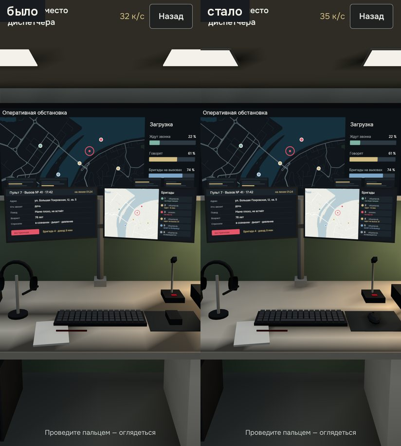

## 4. Сцены

Экраны смены — сцены (ADR [0009](adr/0009-scenes.md)). Каждая — заранее отрендеренный кадр из Blender-скрипта
(`blender/`) и то, что Skia рисует поверх: живая карта, строки, огоньки, карточки. Скрипты, отпечатки и паспорта —
[`02-architecture.md`](02-architecture.md), §10.

**Пульт** — смена. Монитор с картой района почти на весь экран, сидим близко: рамка монитора уходит за края экрана.
В строке программы — часы смены (касание — пауза), скорость и линия. Под картой — вызовы, ждущие бригаду: буква и
цвет формы, номер, сколько ждёт. Внизу — край стола (`blender/pult.py`, Cycles): телефон, клавиатура, гарнитура на
подставке, рация с тангентой, мышь, блокнот, кружка. За столом — зелёная перегородка. Поверх кадра стола Skia рисует
огонёк линии на телефоне, экранчики телефона и рации в перспективе кадра и строку рации над ней. Отделка 21.11.2026:
стол — светлый ламинат с волокнами, корпуса — пластик с мелкой фактурой, блокнот в линейку на пружине, пустой
листок-напоминание, коврик под мышью, чай в кружке, витой шнур трубки, зелёные огоньки питания рации и клавиатуры;
тёплый свет лампы — площадкой (точка отражалась в столе белым кругом у правого края), слева сзади — слабый холодный
свет по кромке тёмных корпусов. Места телефона и рации в кадре прежние.

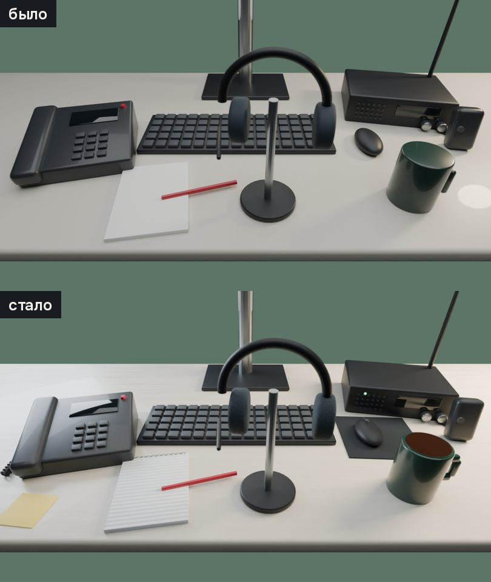

Правка 22.11.2026 (игра владельца: «наушники кривые, один наушник не ровно оторван от дужки»): гарнитура висит на
подставке — оголовье лежит в седле на верху стойки, от концов дуги вниз идут стойки к чашкам, чашки с подушками и
шарнирами зеркальны, микрофон — от левой чашки. До этого дуга висела на 7 см выше стойки, а чашки стояли несимметрично.

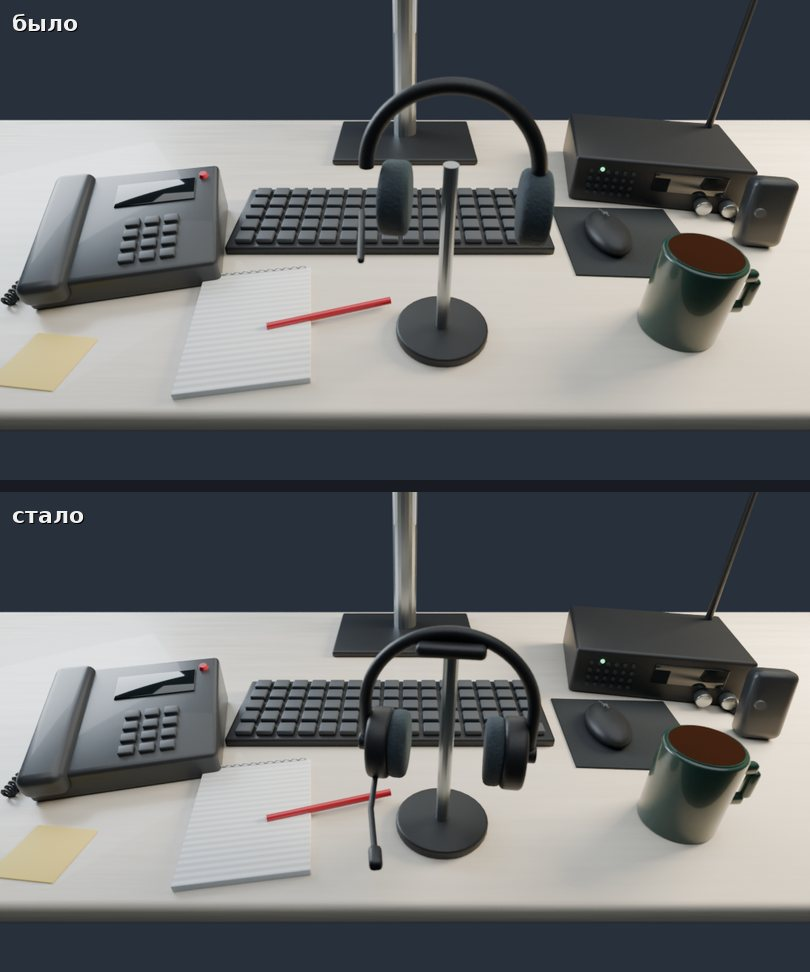

Свет 22.11.2026 (премиум-отделка, [§7](#7-программа-меню-загрузка-итог)): стол был залит ровным светом потолка и
спорил с тёмным залом над ним. Теперь вечер: потолок приглушён, стол освещают монитор сзади — холодноватый свет
слабеет к ближнему краю, в лаке столешницы лежит его отсвет — и тёплая лампа справа, от предметов — мягкие тени.
Skia добавляет свет монитора на перегородке и тень зала на ближнем крае стола. Места телефона и рации прежние:
`pult.gen.ts` — байт в байт.

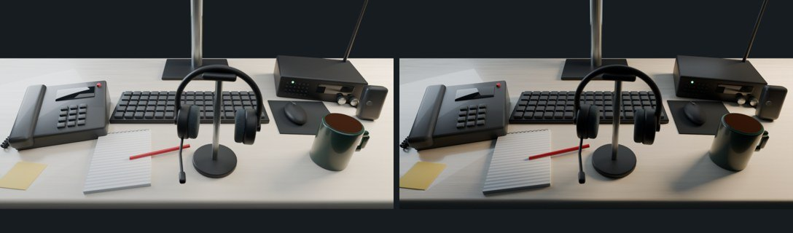

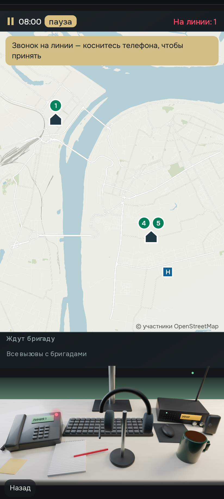

**Звонящий** — разговор. Сверху — звонящий там, откуда звонит: человек Microsoft Rocketbox (MIT) в позе «телефон у
уха», кухня вечером, малая глубина резкости (`blender/caller.py`). Картинок две: женщина (`daughter`, Female_Adult_01) и
мужчина (`man`, Male_Adult_01, с П8); какую показать — по слову звонящего и его полу (`content/callers/`). Звонящий с
улицы (0.11.0) — те же люди на вечерней улице: остановка со светлым щитом, фонарь, дом напротив с окнами, мокрый асфальт
(`daughter-street`, `man-street`); у прохожих — тоже. Рука с телефоном (0.11.0): локоть сбоку и на уровне груди,
предплечье поднимается к уху — до этого подсказка локтя стояла ниже пояса и впереди, и рука шла вертикально от пояса
(игра владельца: «искривлена рука, которая держит телефон»). Хват (0.11.1) — по фотографиям людей с телефоном у уха
(Викисклад, «Woman talking on phone…», 20.11.2026; только образец позы, в игру не берутся): ладонь над серединой
телефона, пальцы лежат поперёк его тыльной стороны и уходят назад, к затылку, кончиками — к голове за ухом; запястье —
у челюсти, предплечье поднимается к лицу почти вертикально, локоть — внизу у рёбер (`CALLER_FINGERS`, `CALLER_WRIST`,
`CALLER_ELBOW` в `blender/caller.py`); телефон — тёмный и матовый. До этого пальцы смотрели вверх
вдоль телефона, а ещё раньше ладонь — наружу (владелец, 20.11.2026: «кисть всё ещё неудовлетворительно»). Его последний
ответ — строкой поверх картинки. Срез, С7 — ещё четыре человека (`grandma`, `grandpa`, `young`, `teen`), дома и на
улице: пожилая женщина (Business_Female_02, в очках) и пожилой мужчина (Male_Adult_03) — их пожилыми ведёт и «Больница»
(`cast.ts`), седину кладёт скрипт: у прядей волос цвет без насыщенности и светлее (`grey`), остальные волосы — в
текстуре головы, и седина там не видна; молодая женщина (Female_Adult_05) и подросток (Male_Child_01), который звонит за
маму или папу. У пожилого мужчины и подростка при прежнем повороте предплечье закрывало рот — они повёрнуты к камере
сильнее (−58°), запястье дальше назад. Кого показать — по слову звонящего, его полу и возрасту больного
(`content/callers/`: жена пожилого — пожилая женщина, жена молодого — молодая).

Отделка 21.11.2026 — все двенадцать картинок заново, поза и хват прежние:

- **Телефон.** Был серым полупрозрачным клином: тёмный корпус на скользящем угле зеркалил светлую стену. Теперь почти
  без блеска (шероховатость 0,85, слабое отражение), со скруглёнными краями и блоком камеры на тыльной стороне.
- **Седина.** У пожилой женщины светлые волосы нарисованы в текстуре головы, седыми были только пряди. Скрипт строит
  маску волос из самой текстуры Rocketbox (волосы темнее кожи и лежат вне лица, ушей и шеи развёртки) и по ней снимает
  насыщенность — седая вся голова. Маска живёт в памяти Blender, в игру не идёт.
- **Сетка.** Грани Rocketbox шли углами на плечах и рукавах — сглажены и поделены один раз.
- **Свет.** Рисующий свет был слева — там рука с телефоном, и на улице пол-лица уходило в тень. Теперь он справа
  спереди, слева — слабое заполнение, сзади слева — контровой: на кухне холодный от окна, на улице тёплый от фонаря.
- **Кадр.** Пожилой мужчина был мельче всех (объектив 52 мм) — теперь 60 мм, как у остальных.
- **Кухня.** Вечер: тёплые стены, окно с переплётом, занавесками и цветком, за стеклом — небо от сиреневого к синему
  и редкие огни, шкафы цвета шалфея с ручками, фартук из плитки, подсветка под шкафами, чайник и банки, холодильник,
  подвес. Диафрагма 2,8 вместо 2,0 — кухня читается, а не тонет в пятнах.
- **Улица.** Широкий тротуар, остановка со светлым щитом, мокрая дорога с лужами, машины у той стороны с красными и
  белыми огнями, дом напротив со светлыми витринами без вывесок, фонари.

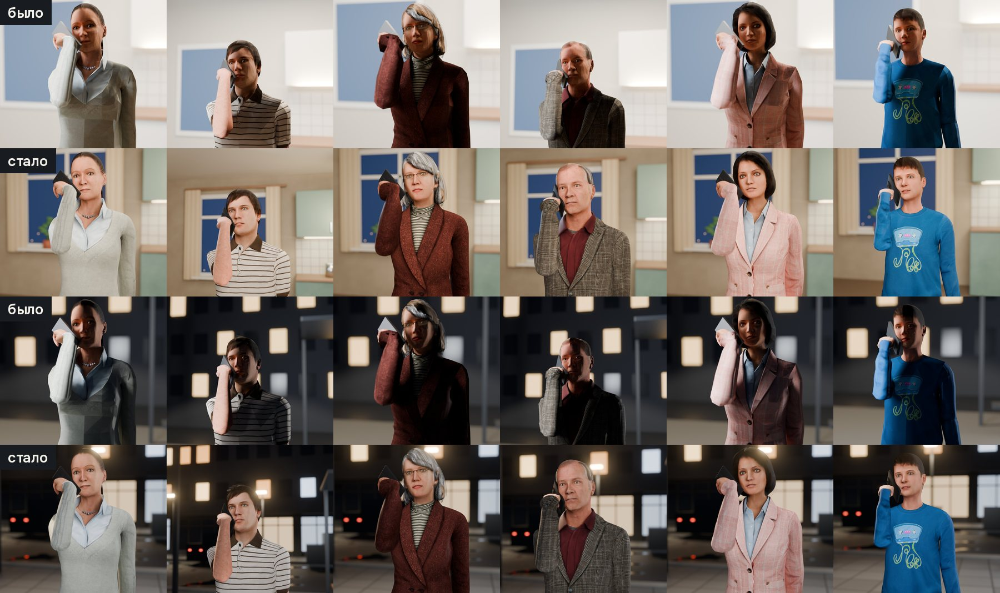

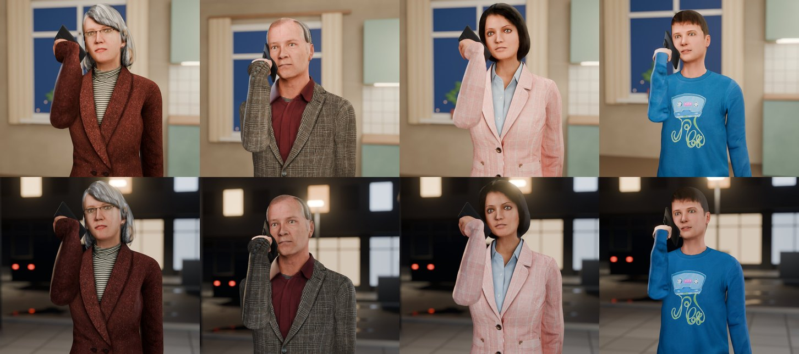

Правки 22.11.2026 по игре владельца («рука вывернута назад», «фото как будто снизу вверх») — все двенадцать картинок
заново; **описания хвата, поворота и кадра выше этим заменены**:

- **Поворот.** FBX Rocketbox приносит действие с ключами поворота скелета; при рендере Blender возвращал человека
  лицом к камере, а кисть, телефон и свет уже были посчитаны для повёрнутого — отсюда и вывернутая рука, и телефон у
  виска. Скрипт снимает действие; `yaw` — поворот от «лицом к камере», 30–34°, правым ухом (с телефоном) к камере.
- **Телефон** лежит на ухе и на щеке: обе точки берутся по сетке головы. Смартфон 152 × 72 × 8 мм: рамка, матовая
  спинка, экран к голове, блок двух камер у верхнего края; верх — у уха, низ — у рта.
- **Хват.** Оси кисти (пальцы, сторона большого пальца, ладонь) меряются по руке в позе покоя, кисть ставится поворотом
  целиком: ладонь — на спинке телефона, к голове; пальцы — наискось вверх, вдоль предплечья с отведением к мизинцу на
  20°, кончиками — за передний край; пятка ладони — у нижнего конца, большой палец — у заднего края. Локоть — внизу
  и впереди. Рот открыт. Ручки: `CALLER_GRIP`, `CALLER_ULNAR`, `CALLER_CURL`, `CALLER_THUMB`, `CALLER_ELBOW`,
  `CALLER_EAR`; `CALLER_DEBUG=1` печатает излом запястья и доли кадра, `CALLER_DRY=1` — без рендера.
- **Кадр — правило.** Камера — на высоте глаз человека (у каждого своя), без наклона: глаза подняты в кадре сдвигом
  объектива (`shift_y`), вертикали остаются вертикалями. Макушка — на 8–12 % высоты от верха, глаза — на трети,
  низ — середина груди; крупность — по расстоянию от макушки до глаз, у всех одна. Сцена «Разговор» режет картинку
  снизу (`pictureRect`), поэтому верх кадра — голова, не потолок.

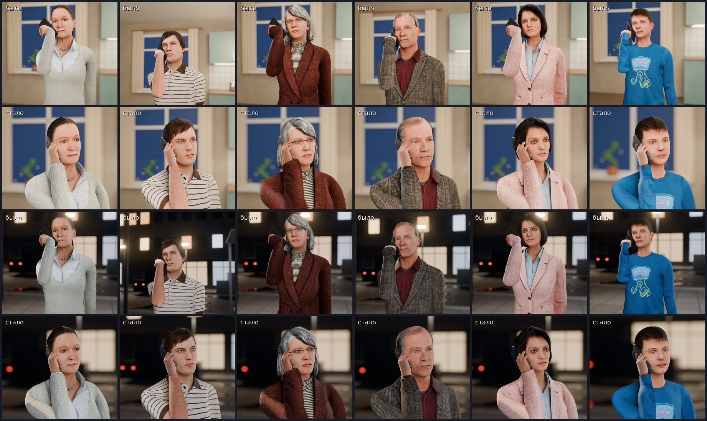

Ниже
— монитор с опросником программы, как на месте диспетчера Московской станции (`mosmed-2024`): номер пульта и счётчик
на линии, поля карточки, вкладки вопросов, вопросы с ценой в игровых секундах, решение — три кнопки формы: цвет,
буква и слово. Заданный вопрос гаснет, его ответ заполняет поле карточки.

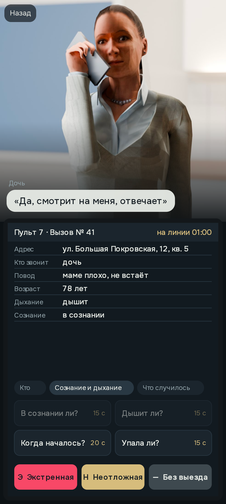

**Видеовставка «бригада выезжает»** — 5 секунд: вечер, двор подстанции, машина скорой выезжает из гаража и уходит из
кадра (`blender/insert.py`). Машина — по ГОСТ Р 50574-2019 (`gost-50574`, [`09-content.md`](09-content.md), «Машина
скорой»): класс B, белая, красная полоса по борту с надписью «СКОРАЯ МЕДИЦИНСКАЯ ПОМОЩЬ», синие маячки на крыше.
Эмблемы «Красный Крест» и марки машины нет. Маячки мерцают мягко, полтора раза в секунду, без резких вспышек.

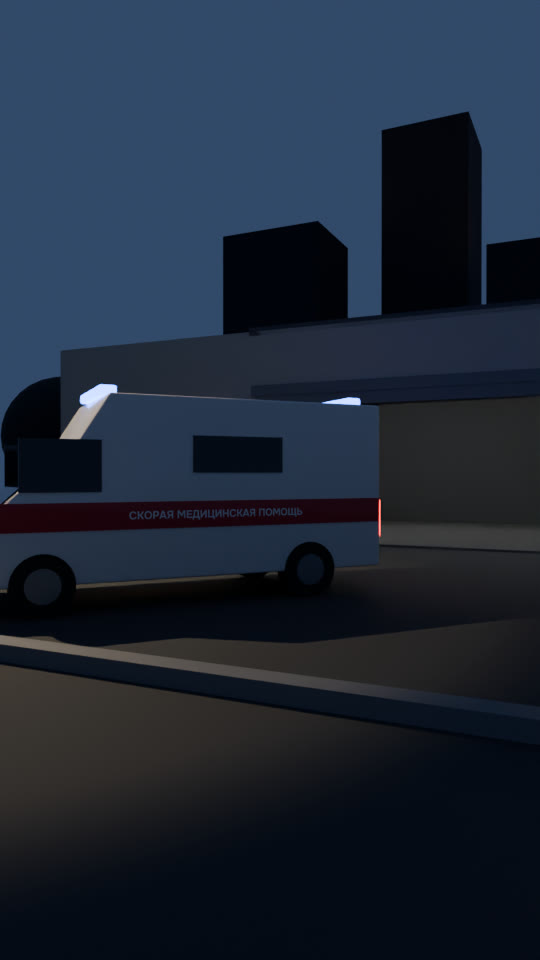

**Видеовставка «начало смены»** (П8) — 4 секунды: тот же двор подстанции вечером, машина стоит у ворот гаража с
включёнными маячками, камера медленно подходит к ней, без рывков. Идёт один раз — после загрузки новой смены.

**Вставки на месте вызова** (срез, С4; [`08-game-design.md`](08-game-design.md), §5) — по 3 секунды, вечер, камера едва
движется: «у подъезда» — панельный дом, подъезд с козырьком и лампой, светящийся домофон, лавочка, машина скорой у
бордюра, маячки на стене; «на остановке» — стеклянный навес с лавкой и жёлтой табличкой без названия и номеров
маршрутов, машина у остановки; «в квартире» — прихожая, входная дверь открыта на тёмную лестницу, из комнаты тёплый
свет, у порога — оранжевая укладка бригады без креста и надписей. Людей нет: игра не показывает помощь
(ADR [0007](adr/0007-game-not-training.md)). Показываются только по касанию бригады на месте или рации.

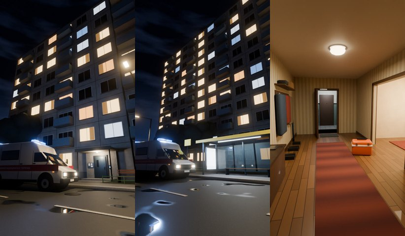

**Отделка вставок 21.11.2026.** Все пять роликов сняты заново — тот же размер, длина и частота кадров.

- **Машина** (общая для вставок и «Станции»): кузов с капотом и обтекателем крыши, тёмные арки и пороги, швы и ручки
  дверей, зеркала, окно кабины по наклону стойки (раньше чёрный прямоугольник торчал за лобовое стекло), решётка, фары
  в корпусах, поворотники, бампер, место номера без знаков, задние двери с окнами, колёса с дисками, маячки на
  основании. Маячки теперь светят на стены и асфальт: передний и задний мерцают в противофазе, мягко, 1,5 раза в
  секунду. Раскраска — та же, по `gost-50574`; эмблемы и марки нет.
- **Двор подстанции** («начало смены», «бригада выезжает»): двухэтажное кирпичное здание с окнами, рольворота из реек,
  вывеска «ПОДСТАНЦИЯ СКОРОЙ МЕДИЦИНСКОЙ ПОМОЩИ» без номера и города, светильники у ворот, в гараже — стеллаж и
  жёлтая полоса, мачта связи с красным огнём, мокрый асфальт с лужами и разметкой, тротуар из плитки на переднем
  плане, забор, деревья, облака. Фонарь переставлен: прежний стоял на пути машины.
- **«У подъезда» и «на остановке».** Нижние 40 % кадра были пустой тёмной дорогой: камера стояла у самой машины и
  смотрела горизонтально. Теперь камера ниже и дальше, смотрит вверх — машина видна целиком, с полосой и надписью,
  дорога — пятая часть кадра, мокрая, с лужами, разметкой и люком. Дом — панели со швами, цоколь, окна с рамами и
  подоконниками, занавески, балконы, свет окон четырёх оттенков. У подъезда — тамбур, дверь с окошком и ручкой,
  козырёк на стойках, лампа в плафоне, доска объявлений без текста, лавки, урна, ограда газона, кусты, деревья; машина
  встала под углом к бордюру. На остановке — навес из трёх стёкол с жёлтой кромкой, светлый щит без рекламы, лавка из
  реек, светильник-линия, знак без названия и маршрутов, дом в двенадцать этажей за деревьями.
- **«В квартире».** Лампа на потолке пересвечивала потолок: точка света висела в 15 см от него. Теперь плафон
  светится сам, а свет идёт вниз площадкой. Прихожая обставлена: обои в полоску, ламинат, плинтус и наличники, дорожка,
  зеркало над тумбой, вешалка с одеждой и полкой, обувь, зонт, картина-пятно, выключатель; в комнате — ковёр, кресло,
  торшер, штора; за открытой дверью — лестничная клетка со светом, перилами и дверью соседей. Укладка — ближе к
  зрителю, с замками.
- **Общее** (`blender/look.py`): шум, швы, полосы и лужи — узлами Blender, без картинок со стороны; после рендера —
  мягкое свечение вокруг фар, маячков, окон и ламп и лёгкое затемнение углов; контраст — «AgX, средне-высокий».

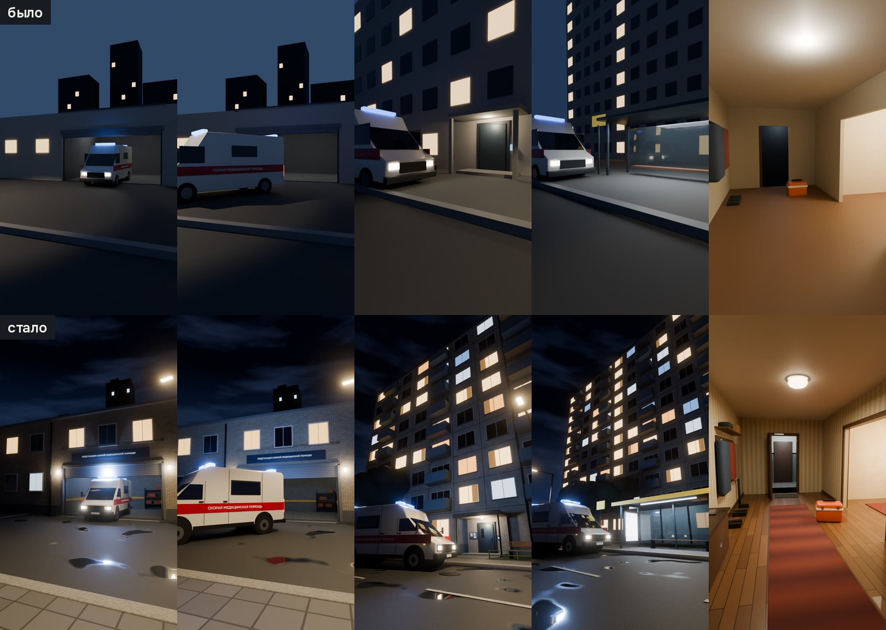

Просьба бригады на месте — окно поверх карты, как доклад: кто и о чём просит, что стоит каждый ответ, сколько осталось
до «сами»; рация говорит то же словами бригады.

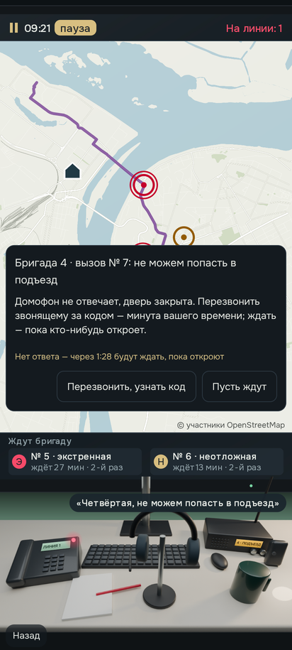

**Станция между сменами** (срез, часть С2; [`08-game-design.md`](08-game-design.md), §15) — рабочее место сверху, днём:
на светлом столе письмо старшего врача на конверте, табель бригад на планшете с зажимом, журнал фонда в зелёной
твёрдой обложке с наклейкой и красно-оранжевая сумка-укладка со светоотражающей полосой и биркой (`388n`, прил. 5);
кружка и карандаш. За окном — двор подстанции: общепрофильная машина класса B, белая, и реанимобиль класса C,
лимонный, с полосой «РЕАНИМАЦИЯ» над полосой «СКОРАЯ МЕДИЦИНСКАЯ ПОМОЩЬ» (`gost-50574`, табл. 1 и 3), без эмблемы
Красного Креста. Кадр — `blender/station.py`, 1080 × 1920; на листы Skia пишет строки письма, табель, фонд и бирку
укладки, синими чернилами; жалобы и пустые укладки — кумачом и словом. Отделка 21.11.2026: стол подходит к зрителю вплотную — серой полосы пола внизу кадра
больше нет, у ближнего края лежат очки, штамп с подушкой, карандаш и скрепки (вне мест касания); стол — ламинат с
волокнами, обложка журнала — бумвинил с корешком и закладкой, сумка — ткань с молнией и второй светоотражающей полосой,
кружка с чаем на подставке, на подоконнике цветок, у окна ручка. Двор: дневное небо (модель неба Blender), кирпичный
гараж с рольворотами и окнами второго этажа, разметка стоянки, фонарь, деревья; машины — новая модель. Места четырёх
предметов и углы листов в кадре прежние.

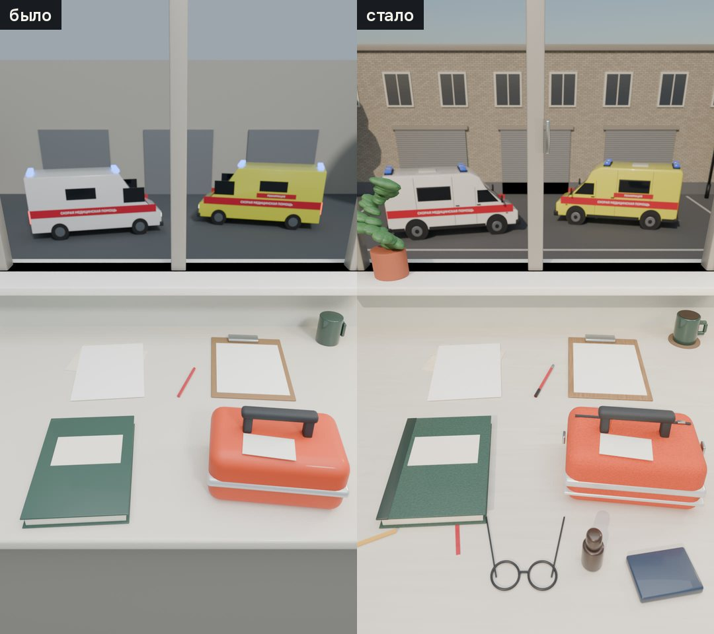

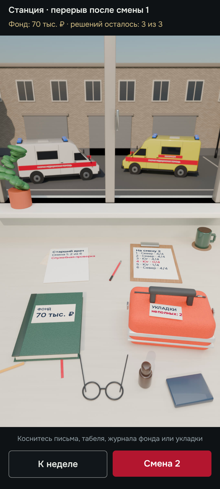

Правила сцен:

- Цвет формы вызова — никогда не единственный знак: у формы ещё буква («Э», «Н») и слово.
- Касание сцены — прозрачные области над нарисованными предметами, у каждой — подпись для чтения с экрана.
- Цвета программы на мониторах, рамок, зала и перегородки — `src/scenes/palette.ts`; цвета предметов из Blender —
  `src/art/palette.ts` (одно место для цвета: скрипты Blender читают оттуда же).
- Вставка не идёт посреди разговора или выбора, пропускается касанием, при «Меньше движения» — один кадр.

## 5. Звук

Синтез своим кодом ([`08-game-design.md`](08-game-design.md), §11; `tools/sound/gen.ts`), записей нет. Каждый звук —
ответ на действие игрока или на событие, которого он ждёт (устав, ADR 0023, правило 6); настройка «Звук» выключает
все, фон тоже.

| Звук | Когда | Какой |
|---|---|---|
| Звонок (`ring`) | новый и повторный звонок; с ним — короткий отклик вибрацией | две трели по 0,45 с: тон между 880 и 1 100 Гц 32 раза в секунду, мягкий фильтр |
| Рация (`radio`) | строка бригады | щелчок тангенты: 45 мс шума и тон 1 750 Гц |
| Касание (`tap`) | кнопка, строка, вопрос, форма | глухой щелчок клавиши, 50 мс, едва слышен; с ним — отклик «клавиша», если отклик включён |
| Трубка (`pickup`) | приняли звонок | два щелчка рычага |
| Послана (`send`) | бригаде назван вызов | две ноты вверх |
| Смена окончена (`done`) | открыт итог, один раз на смену | три тихие ноты, долго гаснут |
| Выезд (`depart`) | вставка «бригада выезжает» | мотор набирает обороты и уходит; вдали — сирена: два тона плавно, без резких верхов |
| У адреса (`idle`) | вставки «у подъезда», «на остановке» | мотор на холостом ходу |
| В квартире (`scene`) | вставка «в квартире» | прибор из укладки коротко пищит три раза и тихо набирает заряд |
| Фон зала (`hall`) | пока идёт смена: пульт и разговор | петля 8 с без шва: вентиляция, гул сети, редкие клавиши соседей, одна далёкая трель |

Правила:

- Звук тише общего уровня телефона (пик от 0,16 у касания до 0,6 у звонка), не звучит на беззвучном и не перебивает
  музыку. Фон зала идёт на половине громкости, под остальными.
- Тревожных петель нет: ничто не звучит, чтобы торопить. Фон — не сигнал: он ровный и не меняется от числа вызовов.
- Звуки вставок — только обстановка. Людей и помощи во вставках нет (ADR [0007](adr/0007-game-not-training.md)):
  прибор в квартире слышен, но не показан.
- В браузере звука нет: там игру только проверяют. Файлы сверяет `tools/test/sound.test.ts` — байт в байт с синтезом,
  наибольшая длина каждого, шов петли.

## 6. Значок и заставка

Вызов «03» на ночной карте района (`tools/art/icon.ts`, 0.10.1; устройство — как у значка «Нард»: слои адаптивной иконки
в единицах 108 dp, градиенты, свет и тень SVG). Фон — ночная карта: слияние двух рек, улицы, тёплый свет сверху слева,
янтарный путь бригады от её знака к вызову и круги вызова на карте. Передний план — метка кумачом с бликом и тенью,
в белом круге — «03» шрифтом Kurale; целиком в безопасном круге 66 dp из 108. Одноцветный слой для тем Android 13 —
силуэт метки с прорезанными цифрами. Креста и машины нет.

Заставка (Android 12+) — тот же значок кругом в 192 dp из поля 288 dp на льне — фоне заглавного экрана; у темы заставки
фон окна тот же (`plugins/with-splash-window.js`, правило устава «два фона»). Уходит на первом кадре заглавного экрана,
не позже 4 с (`src/state/splash.ts`). Файлы и паспорт — `assets/icon.png`, `assets/adaptive-*.png`,
`assets/splash-icon.png`, `assets/icon.json`; руками не правят. Значок для магазина — к 1.0, вместе с карточкой.

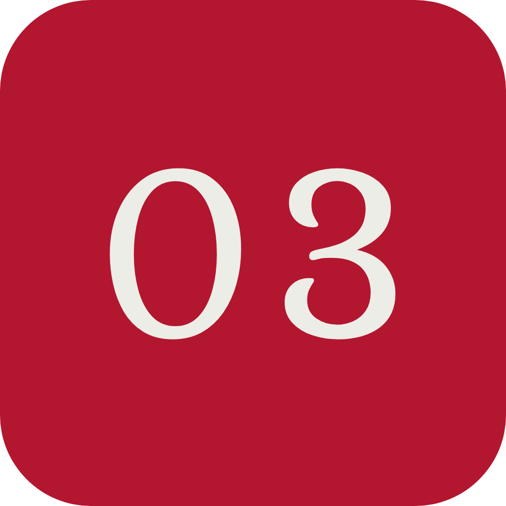

## 7. Программа: меню, загрузка, итог

Премиум-отделка 22.11.2026 (владелец: «довести вид до уровня презентации — как готовый продукт, а не демо»). Отчёт с
проходами и листами — [`reports/2026-11-premium.md`](reports/2026-11-premium.md).

**Одна тёмная программа.** До отделки сцены были тёмными, а выбор смены, настройки, итог и «Об игре» — светлыми, на
льне: игра выглядела двумя разными приложениями. Теперь всё, что не сцена, — программа диспетчерской на стекле поверх
ночного зала. Цвета — «горница вечером» брендбука, те же, что у программ пульта (`UI` в `src/scenes/palette.ts`);
стекло — `GLASS` там же. Светлым остаётся то, что светлое по смыслу: дневная карта, стол станции днём, снимки смены и
недели.

| Что | Правило | Где |
|---|---|---|
| Фон | кадр зала ночью (`blender/title.py`), размытый и приглушённый; рисуется один раз | `src/ui/Backdrop.tsx` |
| Окно и панель | стекло: тёмное, полупрозрачное, линия 1 px, светлая кромка сверху; теней нет | `GLASS`, `src/ui/kit.tsx`, `src/scenes/panel.tsx` |
| Заголовок | Kurale 34, над ним — подпись раздела янтарём с разрядкой | `Screen`, `Overline` |
| Текст | Onest: 17 — основной, 14 — второй, 13 — подписи; числа итога — 64 и 28 | `S` в `src/ui/theme.ts` |
| Отступы | шаг 4: 4, 8, 12, 16, 24 | `G` там же |
| Скругления | кнопка — 6, карточка и строка — 10, окно — 14, ярлык — круг | `R` там же |
| Главная кнопка | кумач, белый текст, одна на экране; под пальцем темнее | `Button` |
| Остальные кнопки | стекло с линией; «тихая» — только текст | `Button kind="ghost"`, `"quiet"` |
| Выключено и закрыто | прозрачность 0,45 и 0,62; у закрытой смены — ещё и строка «Откроется после смены N» | |
| Переключатель | бегунок и слово «вкл.» или «выкл.» — цвет не единственный знак | `Toggle` |
| Действия экрана | полоса внизу, всегда на виду, под большим пальцем | `Screen footer` |
| Цель касания | не меньше 48 точек | `TOUCH` |

**Логотип.** «Диспетчер» шрифтом Kurale и «03» в метке кумачом — как метка вызова на значке игры
([§6](#6-значок-и-заставка)). Под ним — короткая кумачовая нить. Размер логотипа не растёт со ступенью текста.
Отдельной заставки студии нет (брендбук, «Как игры носят бренд», п. 8): игра открывается сразу заглавным экраном.

**Заглавный экран.** Зал диспетчерской ночью — кадр Cycles 1080 × 1920 (`blender/title.py`): тот же зал и стол, что у
сцены рабочего места (`blender/build.py`, та же палитра), светильники приглушены, свет дают видеостена, мониторы и
настольная лампа; малая глубина резкости. Экраны — узлы Blender, без картинок со стороны: «карта» — река полосой шума и
улицы краями ячеек Вороного, «программа» — тёмный фон со строками. Поверх Skia рисует живое: на видеостене расходятся
круги вызова, на столе мигает огонёк телефона — шагами по 0,7 с, а не каждый кадр. Логотип — сверху, меню — стеклянным
окном внизу; строка «Это игра…» — под окном, всегда на виду. Части появляются по очереди за 0,9 с.

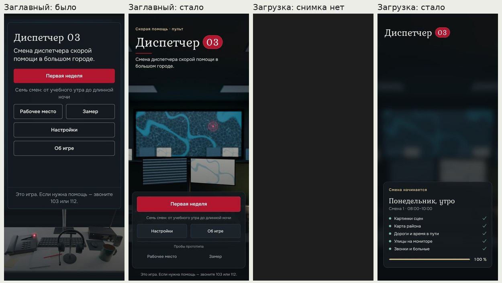

**Загрузка.** Тот же зал, логотип, какая смена начинается, и шаги, которые идут на самом деле: картинки сцен, карта
района, дороги, улицы на мониторе, звонки. Сделанный шаг отмечен точкой и галочкой, идущий — янтарём. Полоса догоняет
шаг за четверть секунды и показывает проценты; ложных таймеров нет.

**Итог смены и недели.** Главное число — крупно, «3 из 7», под ним — что оно значит и полоса доли; три плитки — сколько
ждали неотложные, сколько звонков, сколько минут игры. Числа считают от нуля за 0,9 с. Ниже — главная ошибка с красной
кромкой (или зелёной, если ошибок нет), вызовы смены: форма «решили → по правде» буквами в кружках. Внизу — что дальше:
главная кнопка ведёт на станцию или к неделе, рядом — «Ещё раз» и «Снимок смены».

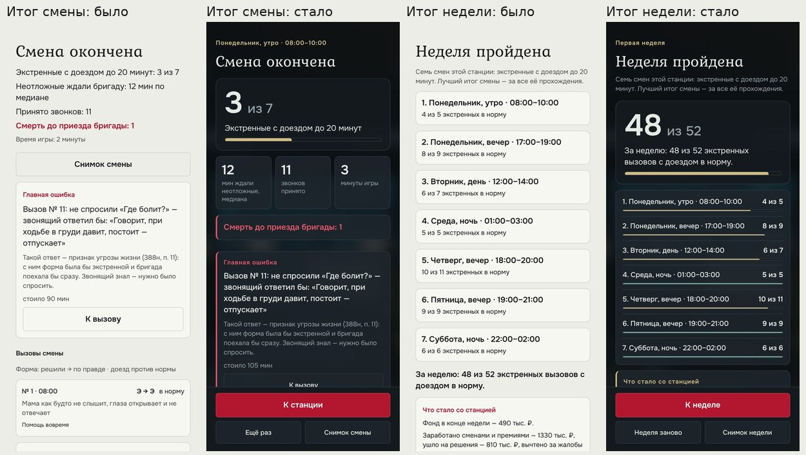

**Пульт и разговор.** Строка программы: часы идут — зелёный треугольник, пауза — две янтарные полосы и слово; звонок на
линии — плашка с точкой. Окно поверх карты — стекло, карта под ним приглушена. Подсказка учебного звонка — стекло с
янтарной кромкой и знаком «i» вместо сплошной янтарной плашки. Предмет под пальцем — телефон, рация, вызов, вопрос,
форма — подсвечен, пока палец на нём.

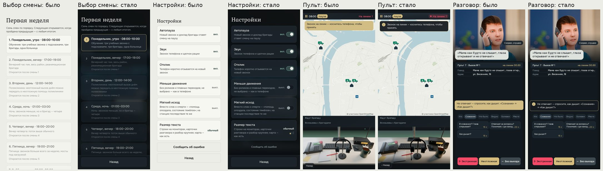

**Движение** (`src/ui/anim.tsx`; брендбук: «короткие переходы без пружин и тряски»):

| Что | Сколько | С «Меньше движения» |
|---|---|---|
| Смена экрана — проявление | 220 мс | сразу |
| Части экрана — проявление и подъём на 10 точек, по очереди | 320 мс | сразу |
| Кнопка под пальцем — сжатие на 2,5 % и темнее | 90 мс | только темнее |
| Числа итога — счёт от нуля; полосы доли | 900 и 700 мс | стоят сразу |
| Карта после пальца — докат с затуханием | до остановки | встаёт сразу |
| Круги вызова и огонёк на заглавном | шаг 0,7 с | круги стоят, огонёк горит |

Всё движение — ответ на действие игрока или смена экрана, которую он сам вызвал; ничего не мигает и не трясётся, чтобы
привлечь внимание.

**Чего нет:** теней под окнами, золота и глянца, градиентов на кнопках, пружин, счётчиков, которые торопят, заставки
студии перед игрой.

