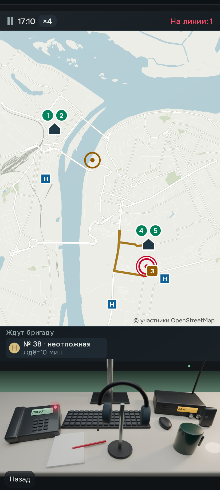
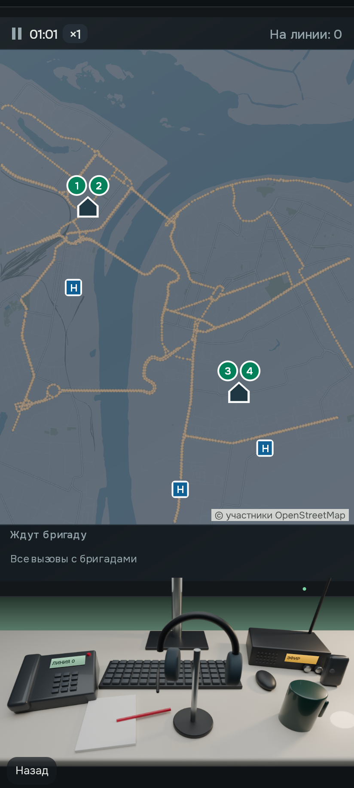
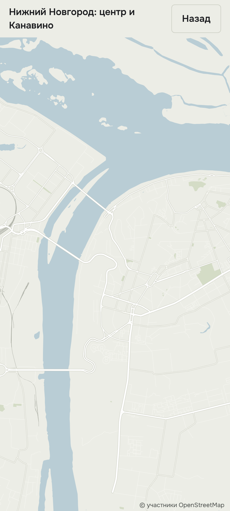
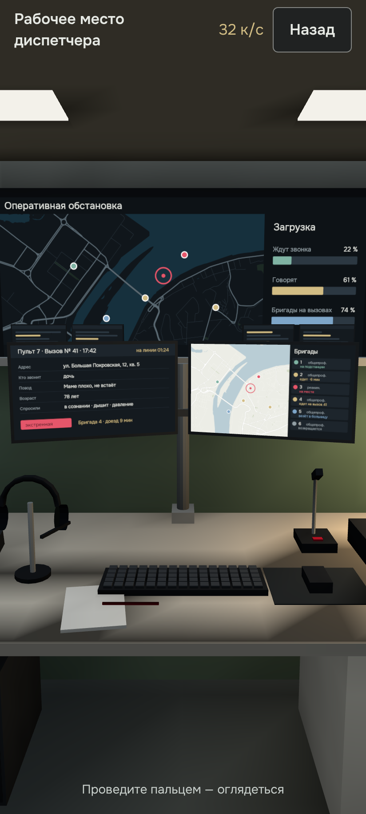
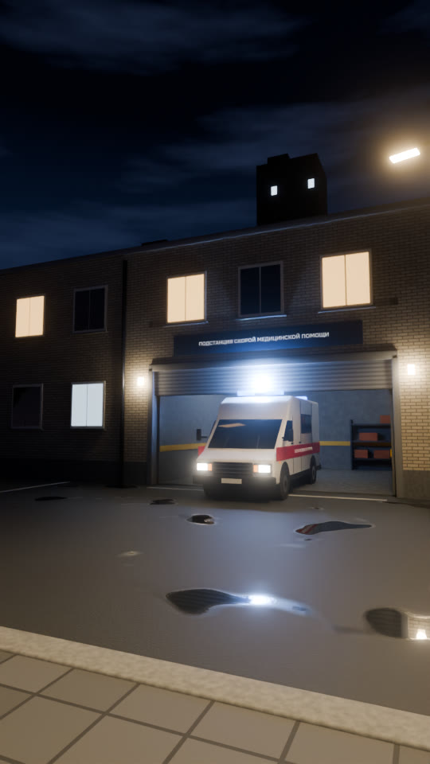

# Вид и звук: лист стиля

Лист стиля игры ([ADR 0023 устава](https://github.com/Nefeste/gornitsa/blob/main/adr/0023-graphics.md), правило 2):
палитра, линии и эталонные кадры. Шрифты и цвета интерфейса — брендбук студии
([`brand/README.md` устава](https://github.com/Nefeste/gornitsa/blob/main/brand/README.md)); здесь — то, что своё у
«Диспетчера 03». Числа геймдизайна — в [`08-game-design.md`](08-game-design.md).

## 1. Карта

Спокойная светлая карта под токенами студии: фон — «лён» брендбука, улицы — белые с серой обводкой, вода и зелень —
приглушённые. Карта — фон для решений, а не картинка: на ней должны читаться бригады и вызовы, которые лягут поверх.

| Слой | Цвет | Ширина на экране | Где в коде |
|---|---|---|---|
| Земля | `#ecede6` («лён», токен `--linen`) | — | `src/ui/map/palette.ts` |
| Вода | `#b9cdd5` | заливка | |
| Зелень (парки, лес) | `#d4dcc6` | заливка | |
| Железные дороги | `#a3a69c` | 1,2 т | |
| Магистрали | `#ffffff`, обводка `#c8cabd` | 5 т + 1,5 т с каждой стороны | `ROAD_PX`, `CASING_PX` |
| Улицы второго класса | `#ffffff`, обводка | 4 т + обводка | |
| Улицы третьего класса | `#fcfcf8`, обводка | 3 т + обводка | |
| Местные улицы | `#f6f6f1` | 1,8 т, без обводки | |

- Ширина улиц на экране не зависит от масштаба. Издалека улицы тоньше, до трети ширины, иначе центр сливается в белое
  пятно (`src/ui/map/MapView.tsx`, `useWidth`).
- При открытии и при наибольшем отдалении карта заполняет экран целиком, без пустых полос; приблизить — до 12 раз.
- Указание «© участники OpenStreetMap» всегда видно в правом нижнем углу карты (ADR [0004](adr/0004-osm-map.md)).
- Знаки (`src/ui/map/Marks.tsx`, цвета — `MARK`, `CREW`, `FORM_MARK` в `src/ui/map/palette.ts`) держат свой размер на
  экране при любом приближении и стоят на белой подложке:

  | Знак | Вид |
  |---|---|
  | Подстанция | тёмно-синий дом `#22343f` |
  | Больница | синий квадрат `#2a5d8f` с белой «H» |
  | Бригада свободна (на подстанции) | зелёный круг `#2f7d5b` с номером |
  | Бригада едет на вызов | коричнево-янтарный квадрат `#8a5d00` с номером; путь — линией того же цвета |
  | Бригада на месте | кумачовый квадрат с номером |
  | Бригада возвращается (свободна) | синий круг `#3d6d99` с номером; путь — линией |
  | Бригада пополняет укладку (срез, С2) | коричневый квадрат `#6d5a3a` с номером; едет пополнять — квадрат цвета возврата |
  | Вызов | кольцо цвета формы; у экстренного — двойное кольцо |

  Цвет — никогда не единственный знак ([`08-game-design.md`](08-game-design.md), §11): у бригады ещё номер и форма
  знака (свободна — круг, занята — квадрат), у вызова — двойное кольцо. Бригады в одном месте встают рядом. Подписи
  улиц — с частью П5.

  
- Ночная карта (срез, С6): поверх вечерней дымки — ещё темнее (`MAP.deepNight`), вдоль магистралей и улиц второго класса —
  фонари через 50 м: светлая середина и мягкий тёплый ореол (`MAP.lampCore`, `lampGlow`), над затемнением и под знаками.
  Точки фонарей — `src/map/lamps.ts`, пути — `cachedLampPaths` (строятся на загрузке смены).

  

## 2. Эталонные кадры

Экраны смены — сцены (ADR [0009](adr/0009-scenes.md)). Эталонные кадры — сначала сюда, потом в код каждой сцены.

| Кадр | Состояние |
|---|---|
| Карта днём — район «Нижний Новгород: центр и Канавино» | ниже, 19.11.2026 (часть П2) |
| Рабочее место диспетчера — сцена Three.js из Blender | [§3](#3-рабочее-место), 19.11.2026 (проба вида) |
| **Смена — пульт**: монитор с картой и вызовами, телефон и рация на столе | [§4](#4-сцены), 19.11.2026 |
| **Звонок — звонящий**: картинка звонящего на месте, карточка вызова, вопросы | [§4](#4-сцены), 19.11.2026 |
| **Вставка «бригада выезжает»**: кадр и ролик 5 с | [§4](#4-сцены), 19.11.2026 |
| Разбор смены | с частью П6 |

Кадры разговора и разбора появятся вместе с этими экранами. Каждый новый кадр — сначала сюда, потом в код.

## 3. Рабочее место

Владелец 19.11.2026: «в Godot нужно сверять не карту, а сцены (комната со столом и мониторами, на одном мониторе карта,
на другом что-то еще, телефон, и прочее - рабочее место диспетчера нужно подумать что в современное рабочее место
входит и нарисовать это) можно нарисовать в blender, визуализировать через three.js». Это **проба вида** к выбору
стека ([uprava#121](https://github.com/Nefeste/uprava/issues/121)): сцена, которую можно сверить с тем же на другом
движке. Станет ли она экраном смены — решит владелец. Как устроена — [`02-architecture.md`](02-architecture.md), §9.

**Что на столе и в зале — по источникам** (ключи — [`09-content.md`](09-content.md), «Рабочее место диспетчера»):

| Предмет | Как в сцене | Источник |
|---|---|---|
| Два монитора | слева — карточка вызова, справа — карта с бригадами и их список | `mosmed-2024`: «на одном мониторе опросник пациента, на другом — карта Москвы»; `388n`, прил. 8, пп. 1–2 — монитор не меньше 48,26 см и дополнительные по потребности |
| Карточка вызова | номер пульта в шапке, счётчик времени на линии, поля адреса, звонящего, повода, возраста | `minzdrav-2018`: в карте вызова есть номер рабочего места (пульта) и индикатор контроля времени |
| Системный блок, клавиатура, мышь | блок под столом слева | `388n`, прил. 8, п. 1 |
| Гарнитура | на подставке слева | `388n`, прил. 8, п. 3; `mos-2025`: диспетчеры «в наушниках» |
| Телефон | IP-аппарат с экранчиком слева | `388n`, прил. 8, п. 4; `aif-2020`: IP-телефония |
| Селектор | микрофон на стойке справа с кнопкой | `388n`, прил. 8, п. 5. **Вид в источниках не описан** — условный |
| Рация | базовая станция с антенной и тангентой справа | `03ekb`, `ampravda-2026`: связь с бригадами по радио. В стандарте `388n` её нет |
| Стол, кресло, тумба | кресло откачено вправо — место ждёт игрока | `388n`, прил. 8, пп. 10–12 |
| МФУ | одно на тумбе у левой стены зала | `388n`, прил. 8, п. 8: одно на пять диспетчеров |
| Перегородки | зелёные | `mos-2025`: зелёные перегородки между местами |
| Видеостена | ночная карта района с бригадами; рядом табло загрузки: доли «ждут звонка», «говорят», «бригады на вызовах» | `03ekb`, `ampravda-2026`: карта на большом настенном экране; `mos-2025`: табло с диаграммами занятости |
| Место | около 2,1 × 2,4 м на диспетчера | `sp-2.2.3670`, п. 249: не меньше 4,5 м² на место с плоским экраном |

Без источника, для обстановки: настольная лампа, кружка, блокнот с ручкой, часы на стене, светильники-панели на
потолке, соседние места с двумя мониторами. Тревожную кнопку (`388n`, прил. 8, п. 6, «по требованию») не ставили:
вид не описан. Расстояние до экрана и освещённость диспетчерской по источникам проверить не удалось.

**Вид:**

- Камера — глаза человека, стоящего за откаченным креслом: 1,44 м над полом, 1,8 м до мониторов, угол обзора 72° по
  вертикали. Палец поворачивает взгляд до 30° вбок и до 12° вверх-вниз; картинка идёт за пальцем.
- Свет — зал вечером: рассеянный холодный сверху, отражённый тёплый снизу, тёплая настольная лампа. Светильники на
  потолке светятся сами. Тени в углах и под предметами — затенение (AO), запечённое в Blender в вершины.
- Цвета предметов — `src/art/palette.ts`: спокойные серые зала, зелёные перегородки, кумач брендбука — огонёк линии,
  кнопка селектора и ручка; ель — кружка.
- Экраны — тёмная тема программы диспетчерской (`src/scenes/desk/screens.ts`), шрифт Onest студии. Цвета состояний
  бригад — пока цвета пробы: свободна — зелёный, едет — янтарный, на месте — красный, везёт в больницу — синий. На
  Московской станции свободные — зелёные, занятые — красные (`mosmed-2024`); лист стиля бригад — с частью П3.
- Данные на экранах — пример вызова для кадра (`src/i18n`, `desk`), не смена.

## 4. Сцены

Экраны смены — сцены (ADR [0009](adr/0009-scenes.md)). Каждая — заранее отрендеренный кадр из Blender-скрипта
(`blender/`) и то, что Skia рисует поверх: живая карта, строки, огоньки, карточки. Скрипты, отпечатки и паспорта —
[`02-architecture.md`](02-architecture.md), §10.

**Пульт** — смена. Монитор с картой района почти на весь экран, сидим близко: рамка монитора уходит за края экрана.
В строке программы — часы смены (касание — пауза), скорость и линия. Под картой — вызовы, ждущие бригаду: буква и
цвет формы, номер, сколько ждёт. Внизу — край стола (`blender/pult.py`, Cycles): телефон, клавиатура, гарнитура на
подставке, рация с тангентой, мышь, блокнот, кружка. За столом — зелёная перегородка. Поверх кадра стола Skia рисует
огонёк линии на телефоне, экранчики телефона и рации в перспективе кадра и строку рации над ней.

**Звонящий** — разговор. Сверху — звонящий там, откуда звонит: человек Microsoft Rocketbox (MIT) в позе «телефон у
уха», кухня вечером, малая глубина резкости (`blender/caller.py`). Картинок две: женщина (`daughter`, Female_Adult_01) и
мужчина (`man`, Male_Adult_01, с П8); какую показать — по слову звонящего и его полу (`content/callers/`). Звонящий с
улицы (0.11.0) — те же люди на вечерней улице: остановка со светлым щитом, фонарь, дом напротив с окнами, мокрый асфальт
(`daughter-street`, `man-street`); у прохожих — тоже. Рука с телефоном (0.11.0): локоть сбоку и на уровне груди,
предплечье поднимается к уху — до этого подсказка локтя стояла ниже пояса и впереди, и рука шла вертикально от пояса
(игра владельца: «искривлена рука, которая держит телефон»). Хват (0.11.1) — по фотографиям людей с телефоном у уха
(Викисклад, «Woman talking on phone…», 20.11.2026; только образец позы, в игру не берутся): ладонь над серединой
телефона, пальцы лежат поперёк его тыльной стороны и уходят назад, к затылку, кончиками — к голове за ухом; запястье —
у челюсти, предплечье поднимается к лицу почти вертикально, локоть — внизу у рёбер (`CALLER_FINGERS`, `CALLER_WRIST`,
`CALLER_ELBOW` в `blender/caller.py`); телефон — тёмный и матовый. До этого пальцы смотрели вверх
вдоль телефона, а ещё раньше ладонь — наружу (владелец, 20.11.2026: «кисть всё ещё неудовлетворительно»). Его последний
ответ — строкой поверх картинки. Срез, С7 — ещё четыре человека (`grandma`, `grandpa`, `young`, `teen`), дома и на
улице: пожилая женщина (Business_Female_02, в очках) и пожилой мужчина (Male_Adult_03) — их пожилыми ведёт и «Больница»
(`cast.ts`), седину кладёт скрипт: у прядей волос цвет без насыщенности и светлее (`grey`), остальные волосы — в
текстуре головы, и седина там не видна; молодая женщина (Female_Adult_05) и подросток (Male_Child_01), который звонит за
маму или папу. У пожилого мужчины и подростка при прежнем повороте предплечье закрывало рот — они повёрнуты к камере
сильнее (−58°), запястье дальше назад. Кого показать — по слову звонящего, его полу и возрасту больного
(`content/callers/`: жена пожилого — пожилая женщина, жена молодого — молодая).

Ниже
— монитор с опросником программы, как на месте диспетчера Московской станции (`mosmed-2024`): номер пульта и счётчик
на линии, поля карточки, вкладки вопросов, вопросы с ценой в игровых секундах, решение — три кнопки формы: цвет,
буква и слово. Заданный вопрос гаснет, его ответ заполняет поле карточки.

**Видеовставка «бригада выезжает»** — 5 секунд: вечер, двор подстанции, машина скорой выезжает из гаража и уходит из
кадра (`blender/insert.py`). Машина — по ГОСТ Р 50574-2019 (`gost-50574`, [`09-content.md`](09-content.md), «Машина
скорой»): класс B, белая, красная полоса по борту с надписью «СКОРАЯ МЕДИЦИНСКАЯ ПОМОЩЬ», синие маячки на крыше.
Эмблемы «Красный Крест» и марки машины нет. Маячки мерцают мягко, полтора раза в секунду, без резких вспышек.

**Видеовставка «начало смены»** (П8) — 4 секунды: тот же двор подстанции вечером, машина стоит у ворот гаража с
включёнными маячками, камера медленно подходит к ней, без рывков. Идёт один раз — после загрузки новой смены.

**Вставки на месте вызова** (срез, С4; [`08-game-design.md`](08-game-design.md), §5) — по 3 секунды, вечер, камера едва
движется: «у подъезда» — панельный дом, подъезд с козырьком и лампой, светящийся домофон, лавочка, машина скорой у
бордюра, маячки на стене; «на остановке» — стеклянный навес с лавкой и жёлтой табличкой без названия и номеров
маршрутов, машина у остановки; «в квартире» — прихожая, входная дверь открыта на тёмную лестницу, из комнаты тёплый
свет, у порога — оранжевая укладка бригады без креста и надписей. Людей нет: игра не показывает помощь
(ADR [0007](adr/0007-game-not-training.md)). Показываются только по касанию бригады на месте или рации.

Просьба бригады на месте — окно поверх карты, как доклад: кто и о чём просит, что стоит каждый ответ, сколько осталось
до «сами»; рация говорит то же словами бригады.

**Станция между сменами** (срез, часть С2; [`08-game-design.md`](08-game-design.md), §15) — рабочее место сверху, днём:
на светлом столе письмо старшего врача на конверте, табель бригад на планшете с зажимом, журнал фонда в зелёной
твёрдой обложке с наклейкой и красно-оранжевая сумка-укладка со светоотражающей полосой и биркой (`388n`, прил. 5);
кружка и карандаш. За окном — двор подстанции: общепрофильная машина класса B, белая, и реанимобиль класса C,
лимонный, с полосой «РЕАНИМАЦИЯ» над полосой «СКОРАЯ МЕДИЦИНСКАЯ ПОМОЩЬ» (`gost-50574`, табл. 1 и 3), без эмблемы
Красного Креста. Кадр — `blender/station.py`, 1080 × 1920; на листы Skia пишет строки письма, табель, фонд и бирку
укладки, синими чернилами; жалобы и пустые укладки — кумачом и словом.

Правила сцен:

- Цвет формы вызова — никогда не единственный знак: у формы ещё буква («Э», «Н») и слово.
- Касание сцены — прозрачные области над нарисованными предметами, у каждой — подпись для чтения с экрана.
- Цвета программы на мониторах, рамок, зала и перегородки — `src/scenes/palette.ts`; цвета предметов из Blender —
  `src/art/palette.ts` (одно место для цвета: скрипты Blender читают оттуда же).
- Вставка не идёт посреди разговора или выбора, пропускается касанием, при «Меньше движения» — один кадр.

## 5. Звук

Синтез своим кодом ([`08-game-design.md`](08-game-design.md), §11; `tools/sound/gen.ts`), записей нет:

- **Звонок** — две трели по 0,45 с с паузой: тон переключается между 880 и 1 100 Гц 32 раза в секунду, мягкий фильтр
  снимает резкость. Звучит на новом и повторном звонке; с ним — короткий отклик вибрацией.
- **Рация** — щелчок тангенты: 45 мс шума и короткий тон 1 750 Гц. Звучит на строке бригады.

Звук тише общего уровня телефона (пик 0,6 и 0,45), не звучит на беззвучном и не перебивает музыку. Тихий фон
оперативного отдела — после прототипа.

## 6. Значок и заставка

Вызов «03» на ночной карте района (`tools/art/icon.ts`, 0.10.1; устройство — как у значка «Нард»: слои адаптивной иконки
в единицах 108 dp, градиенты, свет и тень SVG). Фон — ночная карта: слияние двух рек, улицы, тёплый свет сверху слева,
янтарный путь бригады от её знака к вызову и круги вызова на карте. Передний план — метка кумачом с бликом и тенью,
в белом круге — «03» шрифтом Kurale; целиком в безопасном круге 66 dp из 108. Одноцветный слой для тем Android 13 —
силуэт метки с прорезанными цифрами. Креста и машины нет.

Заставка (Android 12+) — тот же значок кругом в 192 dp из поля 288 dp на льне — фоне заглавного экрана; у темы заставки
фон окна тот же (`plugins/with-splash-window.js`, правило устава «два фона»). Уходит на первом кадре заглавного экрана,
не позже 4 с (`src/state/splash.ts`). Файлы и паспорт — `assets/icon.png`, `assets/adaptive-*.png`,
`assets/splash-icon.png`, `assets/icon.json`; руками не правят. Значок для магазина — к 1.0, вместе с карточкой.

