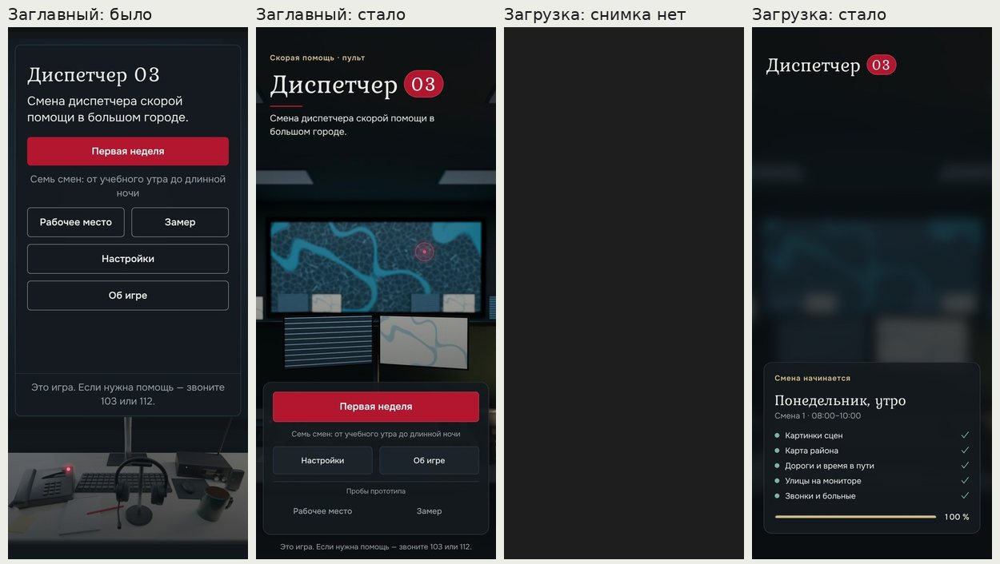
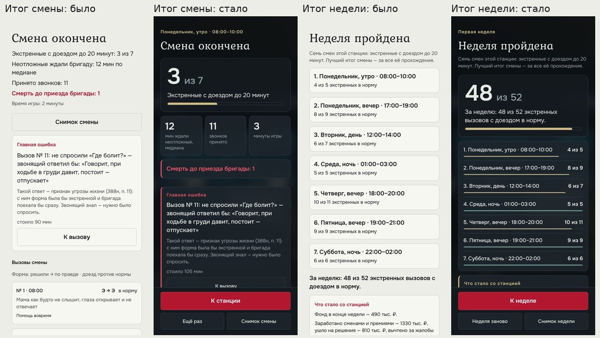
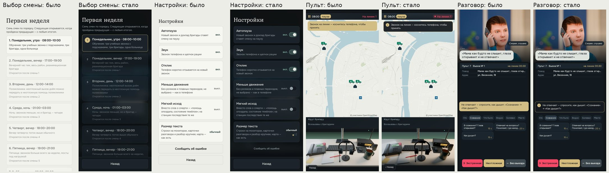
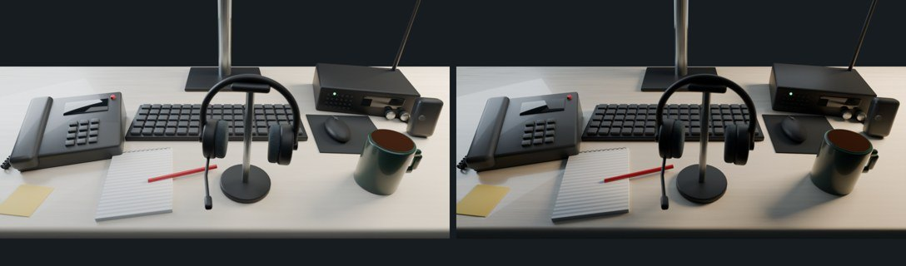

# Премиум-отделка: вид и ощущение всей игры

22.11.2026. Ветка `claude/premium-look` от 0.31.0 (`claude/map-beacons`). Версия, «Версии» в README и `STATUS.md` не
тронуты — их меняет главная сессия.

**Задача владельца.** «Довести вид приложения (кнопки и весь интерфейс) до уровня презентации — чтобы выглядело как
готовый продукт, а не демо»: фирменный заглавный экран и настоящий экран загрузки, реалистичный свет, чистые пульт и
меню, звук, плавное управление, экран итога. Проверка — сценарий в браузере без окна, снимок каждого экрана, критика
снимков и не меньше двух полных проходов улучшений.

**Правила, по которым шла работа.** Устав: ADR 0023 (одна палитра, скрипты с паспортом, лист «до — после», отклик
только на действие игрока, «Меньше движения»), ADR 0010, брендбук. Игра: [`../13-art.md`](../13-art.md),
ADR [0009](../adr/0009-scenes.md) (сцены), ADR [0007](../adr/0007-game-not-training.md) (игра, а не обучение).
Правила вида записаны в лист стиля: [`../13-art.md`](../13-art.md), §5 «Звук» и §7 «Программа: меню, загрузка, итог».

## 1. Что смотрели

Сценарий `tools/e2e/browser.ts` проходит всю игру и снимает 49 экранов, 412 × 915 точек, плотность 2:

| Группа | Снимки |
|---|---|
| Запуск | заглавный, настройки, выбор смены, загрузка |
| Смена | вставка «начало смены», ввод, карточка бригады, звонок на пульте, разговор (три шага), окно бригад, вставка «выезд», пульт с бригадами, ждущий вызов, перезвон, доклад, просьба бригады, вставка на месте |
| После смены | итог, снимок смены, разбор вызова, станция (стол, письмо, табель, закупки) |
| Неделя | неделя после смены, неделя пройдена, итог недели, снимок недели, неделя заново, свободная смена и её пульт ночью |
| Остальное | рабочее место (два кадра), «Об игре», «Сообщить об ошибке», «Замер» (три кадра), экран сбоя |
| Крупный текст | настройки, заглавный, выбор смены, пульт — на ступенях «крупнее» и «крупный» |

## 2. Исходное состояние: критика

Снимки 0.31.0 — левые половины листов ниже.

| Экран | Что не так |
|---|---|
| Заглавный | Название — просто строка текста. Окно меню занимает две трети экрана, нижняя его половина пуста. Сцены почти не видно: тёмный прямоугольник и приглушённый край стола. Шесть кнопок одного веса, пробы прототипа стоят наравне с «Настройками» |
| Загрузка | Строка, полоса и подпись на пустом тёмном фоне. Какая смена начинается — не сказано |
| Выбор смены, настройки, «Об игре», итог, разбор | Светлые экраны на льне, а сцены тёмные: игра выглядит двумя приложениями. Переход из тёмного пульта в светлый итог бьёт по глазам |
| Настройки | «вкл.» и «выкл.» мелким текстом справа — не видно, что это переключатель |
| Итог смены | Столбец строк одного размера: главное число не отличается от «Время игры». Главная кнопка — «Ещё раз», хотя дальше по пути — станция |
| Итог недели | Семь одинаковых карточек, итог недели — строкой под ними |
| Пульт | Стол залит ровным дневным светом, а зал над ним тёмный. Подсказка — сплошная янтарная плашка, спорит с картой. Линия со звонком — красный текст без знака. Окно поверх карты сливается с картой |
| Разговор, пульт | Вопросы, формы, телефон и рация не отвечают на палец: нажатие ничем не отмечено |
| Карта | Останавливается в ту же секунду, как убран палец |
| Звук | Два звука на всю игру: звонок и щелчок рации |
| Переходы | Экраны сменяются скачком |

## 3. Первый проход

Что сделано:

1. **Одна тёмная программа** (`src/ui/kit.tsx`, `src/ui/Backdrop.tsx`, `src/scenes/palette.ts`): всё, что не сцена, —
   стекло поверх ночного зала. Один набор: текст, кнопка трёх видов, карточка, строка, переключатель, плитка числа,
   полоса доли, экран с заголовком и нижней полосой действий. Отступы и скругления — из одной таблицы.
2. **Кадр зала для заглавного экрана** — `blender/title.py`: тот же зал и стол, что у сцены рабочего места
   (`blender/build.py`), ночью, в Cycles. Паспорт — `assets/scenes/title.json`, места огонька и вызова —
   `src/art/title.gen.ts`, тест — `tools/test/scenes.test.ts`.
3. **Заглавный экран**: логотип «Диспетчер 03», живые круги вызова на видеостене, меню — окном внизу, пробы прототипа —
   мелко под ним.
4. **Загрузка**: зал, логотип, смена, шаги с настоящим ходом. Новый шаг «Картинки сцен»: стол пульта и двенадцать
   звонящих (`Asset.loadAsync`) — раньше первый звонок мог ждать файла.
5. **Свет пульта** — `blender/pult.py`: вечер вместо ровного света потолка; `pult.gen.ts` — байт в байт прежний.
6. **Пульт**: знак «идёт — пауза», плашка линии, стекло окон, карта под окном приглушена, подсказка на стекле.
7. **Итог смены и недели**: главное число, плитки, счёт от нуля, главная ошибка с кромкой, строки вызовов с буквами
   форм, нижняя полоса действий.
8. **Движение** (`src/ui/anim.tsx`): проявление экрана и частей, отклик кнопки.
9. **Звук** (`tools/sound/gen.ts`, `src/audio/feedback.ts`): касание, трубка, «послана», конец смены, три звука вставок,
   фон зала петлёй.

Критика снимков первого прохода:

| Экран | Замечание | Что сделано во втором проходе |
|---|---|---|
| Кадр зала | Мониторы с «программой» — яркие белые полосы, «карта» выбелена, зал резкий — видна простая геометрия | Кадр снят заново: строки программы тихие, карта тусклее, диафрагма 1,0 — зал за мониторами размыт |
| Выбор смены | Номер смены стоит дважды: в кружке и в строке «1. Понедельник…». Закрытые смены слишком бледные | В строке — только день и часы; прозрачность закрытых 0,62 вместо 0,5 |
| Настройки, «Об игре» | «Сообщить об ошибке» в нижней полосе переносится на две строки | Ушла в конец списка тихой кнопкой; в полосе — одна «Назад» |
| Итог смены | Цифры плиток разрежены: «1 2» | Табличные цифры у крупных чисел убраны |
| Итог недели | Под каждой сменой строка повторяет число справа | Строка — только когда есть что добавить: исходы, лучший итог другого прохождения |
| Заглавный, крупный текст | Логотип вырос вместе с текстом, «03» ушло на вторую строку | Размер логотипа не растёт со ступенью текста |
| Загрузка | Снимок чёрный: сценарий снял экран раньше, чем тот проявился | См. «Сценарий» ниже |
| Разговор, пульт | Предметы сцен по-прежнему не отвечают на палец | Вопрос, форма, вызов, телефон и рация подсвечены, пока палец на них; касание — с откликом |
| Карта | Встаёт сразу | Докат с затуханием; «Меньше движения» — сразу |

## 4. Второй проход

Сделано то, что в правом столбце таблицы выше. Критика снимков второго прохода:

| Экран | Замечание | Что сделано |
|---|---|---|
| Итог недели | На снимке «47 из 52» при итоге 48: снято посреди счёта | Сценарий ждёт конца движения перед снимком (1,1 с) |
| Заглавный, крупный текст | Сквозь главную кнопку видны полосы монитора: снято посреди появления окна | То же |
| Загрузка | На снимке уже вставка: в браузере шаги загрузки идут одним куском, экран не успеть снять | `?loading=hold` — экран ждёт касания, когда всё загружено; сценарий снимает его отдельной страницей |
| Загрузка | «1. Понедельник, утро · 08:00–10:00» переносится посреди строки | День — заголовком, под ним «Смена 1 · 08:00–10:00» |

После второго прохода замечаний к снимкам, которые можно исправить без нового рендера, не осталось. Что видно и
оставлено — в разделе 7.

## 5. Листы «до — после»

Слева — 0.31.0, справа — эта ветка. Те же зерно смены и размер окна. Экран загрузки на 0.31.0 сценарий не снимал —
снимка «было» нет: там были строка «Смена начинается», полоса и подпись шага на пустом тёмном фоне.

**Заглавный экран и загрузка**

**Итог смены и итог недели**

**Выбор смены, настройки, пульт, разговор**

**Стол пульта: свет**

## 6. Проверки

| Проверка | Итог |
|---|---|
| `npm run typecheck` | чисто |
| `npm run lint` | 0 предупреждений |
| `bun test tools/test` | 259 прошли, 1 пропущен, 0 упали |
| `npm run export:web` + сценарий в браузере | 170 проверок, 48 снимков, пройден (после исправления утечки — см. ниже) |
| Ошибки в консоли браузера | 0 |
| Текст кнопок внутри кнопок (`buttonsFit`) | на каждом снимке, три ступени текста |
| Образцы сохранений, эталонные смены | зелёные: движок и содержание не тронуты |

**Сценарий.** До этой работы сценарий на этой машине падал на 0.31.0: «ждущему не перезвонили». Перезвонить можно
только на свободной линии, а на медленной машине (Chromium рисует программно) новый звонок всегда успевал прийти раньше
окна. Теперь сценарий сначала ставит часы на паузу. Это правка сценария, не игры.

**Два сбоя сценария — причина найдена (главная сессия, 22.11.2026).** Из восьми прогонов агента два упали без понятной
причины: вкладка Chromium упала посреди смены; на итоге не загрузились картинка зала и шрифты снимка. Первый прогон
главной сессии упал так же, и на снимке карточки бригады карта уже была пустой, а стола под ней не было. Замер кучи
CanvasKit (Skia в вебе) по ходу сценария: 0.31.0 — 134 → 1 498 МБ за 5 минут смены, эта ветка — так же. Причина —
`useImage` и `useFont` Skia: файл грузится при каждом появлении экрана, а в вебе объект Skia не освобождается сам, и
раскодированная картинка остаётся в куче (~13 МБ на переход «заглавный — настройки»). У предела кучи новые картинки и
шрифты не создаются — отсюда пустая карта и выключенный «Снимок смены». Утечка была и в 0.31.0; премиум-отделка её не
внесла, но приблизила: кадр зала на каждом экране программы. Исправлено в 0.32.0: картинки и шрифты — один раз на игру
(`src/ui/skiaAssets.ts`, правило линтера запрещает `useImage` и `useFont` напрямую), прежняя картинка холста в вебе
освобождается (`src/ui/skiaWeb.ts`). После: 20 переходов «заглавный — настройки» — 134 МБ без роста (было 401), смена
сценария — не выше 334 МБ, сценарий пройден (170 проверок, 48 снимков). Подробно — `docs/06-testing.md`.

## 7. Что не сделано и почему

- **Замер кадра на телефоне.** У агента нет телефона. Устав (ADR 0023, правило 5) не выпускает версию с новой графикой
  без замера: «Замер» на телефоне владельца — до тега. Новое на кадр: размытый фон у экранов программы (рисуется один
  раз), проявление экрана 220 мс, докат карты.
- **Звук на слух не проверен.** В браузере звука нет, слушать агенту нечем. Проверены байты, длина, пик и шов петли.
  Громкость и тембр фона, касания и сирены нужно послушать на телефоне.
- **Станция, звонящие, вставки не пересняты.** У вставок и звонящих свет уже вечерний, с тенями и отражениями
  (отделка 21–22.11). Станция — день по смыслу. Пересъёмка всего — больше трёх часов рендера; сделаны два кадра,
  которые игрок видит чаще всего: стол пульта и зал заглавного экрана.
- **«Замер» и рабочее место** — пробы прототипа: получили общие кнопки и тёмный фон, вёрстка прежняя.
- **Экран сбоя** — без картинки зала и без движения нарочно: он не должен упасть сам.
- **Зал заглавного экрана собран из простых коробок** — это модель сцены рабочего места. Размытие и темнота это
  скрывают, но кресел, проводов и людей в зале нет.
- **Писк и заряд прибора во вставке «в квартире»** — только звук обстановки; прибора и людей в кадре нет (ADR 0007).
  Если владелец сочтёт, что и звук лишний, — убирается одной строкой в `src/screens/InsertScreen.tsx`.

## 8. Что нужно от владельца

1. **Системная заставка Android** была светлой (лён), а первый экран игры теперь тёмный: при запуске мигал бы светлый.
   В 0.32.0 главная сессия поставила ночной цвет `#0e1215` в двух местах `app.json` (путь владельца, PR сливает
   владелец); плагин `plugins/with-splash-window.js` берёт его сам. Нужно одобрение в PR.
2. **Экраны программы стали тёмными.** Брендбук называет основой лён; тёмная тема в нём есть («горница вечером»), и
   игра взяла её целиком. Это решение о виде игры — оно записано в `13-art.md`, §7, и ждёт одобрения в PR.
3. **Три эталонных кадра** (ADR 0023, правило 2): заглавный экран, пульт вечером и итог смены — кандидаты на замену
   прежних в `13-art.md`, §2.
4. **Замер и звук на телефоне** — см. раздел 7.
